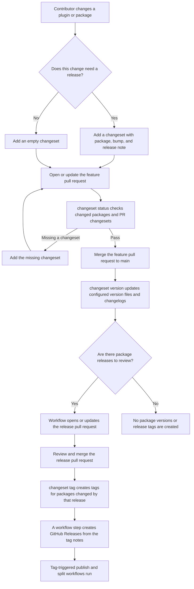

# Changesets

Record the release impact of a pull request, then bump versions, write the changelog and create tags from the notes.

A changeset is a small Markdown file that says which package a pull request changes, how big the change is and what to tell users. You don't write it by hand: `changeset add` creates it. Four commands turn the files into a release: `add`, `status`, `version` and `tag`.

In a terminal, run `add` without options. It lists the packages, preselects the ones that changed since the base branch, and asks for the bump of each and the release note. In scripts and CI, pass the answers as options. `--empty` records that a change needs no release, and `--name` sets the file name instead of a random one:

```sh
npx @wpelevator/wp-release changeset add --bump minor --summary "Add a settings page."
```

```text
Created /home/me/my-plugin/.changeset/a1b2c3d4.md.
```

The command wrote this file. Commit it with the pull request, and edit it only to reword the note:

```text
---
"my-plugin": minor
---

Add a settings page.
```

`status` lists the pending releases, and checks that the pull request has a changeset:

```sh
npx @wpelevator/wp-release changeset status --since main
```

```text
my-plugin: 1.4.2 → 1.5.0 (minor)
```

`version` applies the changesets: it bumps the version files, writes the changelog and deletes the changeset files. Preview it with `--dry-run`:

```sh
npx @wpelevator/wp-release changeset version
```

```text
my-plugin: 1.4.2 → 1.5.0 (minor)
```

The changelog gets the entry:

```text
## 1.5.0 (2026-11-13)

- Add a settings page.
```

After the release is merged, `tag` creates the tag, and `--dry-run` shows the release notes first:

```sh
npx @wpelevator/wp-release changeset tag --dry-run
```

```text
Would create v1.5.0
- Add a settings page.
```

```sh
npx @wpelevator/wp-release changeset tag
```

```text
Created v1.5.0
```

To run these steps in GitHub Actions, see [Release from GitHub Actions](release-workflow.md). For several packages in one repository, see [Release a monorepo](monorepo-releases.md). For release candidates and test builds, see [Pre-releases and snapshots](prereleases.md). The commands read Changesets-style Markdown and keep to its frontmatter format, with `package-name: patch|minor|major` entries, rather than general YAML or the Changesets pre mode.

Projects that don't use Node.js can run the same workflow with [PHP Changesets](../../../php/php-changesets/docs/index.md), a Composer package that needs only PHP and Git. Its `changeset add`, `changeset status`, `changeset version` and `changeset tag` commands take the options of the commands here, read the same changeset files and print the same release plans, with a PHP config file in place of `wp-release.config.*`. Use `wp-release` when the project already builds with Node.js, or to also build ZIPs, translations and WordPress.org deploys; see the [comparison](../../../php/php-changesets/docs/comparison.md) for the differences.

## Add a changeset

Add release notes in a feature PR with `npx @wpelevator/wp-release changeset add`. In a terminal, it lists the packages, marks the ones that changed since `<remote>/<baseBranch>` (or `--since <ref>`) without a changeset, and asks for the packages to release, a `patch`, `minor` or `major` bump for each, and the release note. Choose packages by number, identifier or path, or press Enter to release the changed ones; `none` adds an empty changeset. Changed files include uncommitted and untracked ones, since changesets are usually added before committing.

Without a terminal, or for scripts, pass the changeset as options: `npx @wpelevator/wp-release changeset add --package @vendor/plugin --bump patch --summary "Fix the checkout validation."`. Repeat package and bump flags for multiple packages, or use `--empty` when no release is needed. A package can also be named by its path under `root`, like `plugins/alpha`, and the changeset records its identifier; `changeset version --package` and `changeset tag --package` accept paths too. A single `--bump` without `--package` releases every changed package without a changeset, like `changeset add --bump patch --summary "…"` to fix a failing `changeset status` check. `--json` and `--github-output` never ask.

## Check pull requests

In CI, `changeset status --since origin/main` requires a changeset added by the PR; changesets already on the base do not count, while an empty PR changeset records an explicit no-release decision. Missing-change annotations identify an affected file.

## Version a release

On the release branch, preview with `changeset version --dry-run`, then run `changeset version` to update version targets and changelogs. `--date <YYYY-MM-DD>` sets the changelog date, which is today by default. By default, new Markdown entries go before the first version heading; `changelogInsertAfter` sets a literal insertion marker for `CHANGELOG.md` and, with `readmeChangelog`, the plugin readme. Put the marker in both files; a missing marker is an error. Without a marker, plugin readmes use the `== Changelog ==` heading. Failed updates are rolled back for safe retries.

Configure `changelogEntry( { package, changeset, commit } )` to format the changelog entry of each changeset, where `commit` is the `{ hash, shortHash, subject }` of the commit that added the changeset file, if it's committed. The formatted entries go into `CHANGELOG.md`, the `changelog` of each release in the `changeset version` result, and so the release notes; plugin readmes keep the plain summaries. Without the callback, entries are the plain summaries. For example, to link each entry to its commit:

```js
changelogEntry: ( { changeset, commit } ) =>
	commit
		? `${ changeset.summary } ([\`${ commit.shortHash }\`](https://github.com/me/repo/commit/${ commit.hash }))`
		: changeset.summary,
```

The `changeset version` result lists each release with its `package`, `bump`, `currentVersion`, `nextVersion` and `changelog` entries, a Markdown list like the one added to `CHANGELOG.md`. Use it to name and describe the release pull request in a repository script, or call `versionChangesets()` from the library and format the entries of each release with `formatChangelogEntries( release.changesets )`.

## Tag a release

After merging the release PR, `changeset tag --since <merge-commit>^1 --push` pushes tags only for packages changed by that release. A workflow that runs on every push to the base branch can use `--since HEAD^1` instead, since a tag is only created when it doesn't exist yet; see the [single-package workflows](release-workflow.md#open-the-release-pull-request-and-tag-the-release). It pushes one tag at a time because GitHub doesn't trigger workflows for a push of more than three tags. wp-release doesn't create GitHub Releases: with `--json` or `--github-output`, each entry of `tags` has the `tag`, a `title` like `plugins/alpha@1.2.0` or, for a package at the repository root, the release title like `1.2.0` (see [releaseTitle](monorepo-releases.md#packages-and-tags), and `--release-title` for overriding it in one command), the release `notes` and a `prerelease` flag, for a workflow step like [`softprops/action-gh-release`](https://github.com/softprops/action-gh-release) to create the release (see the example below). For initial adoption, preview all missing tags with `changeset tag --dry-run` (without `--since`), then push if needed. To release each package with a separate workflow instead, `changeset tag --since <merge-commit>^1 --untagged --github-output` lists the releases that don't have a tag yet, without creating any. Tag pushes need Git write credentials.

To release a single package, for example from a manual workflow, pass `--package <name>`, repeatable, and with one package `--version <version>` to fail unless the package is at that version. Packages versioned by git tags have no version file, so for them `--version` is the version to tag. Before a tag is created, every `version.to` target must match the version, so a plugin `Version` header that disagrees with its readme `Stable tag` blocks the tag. Versions with a pre-release part, like `1.0.0-rc.1`, have `prerelease` set, so their GitHub Releases can be marked as pre-releases. This example selects one package, so `tags[0]` is its release; these fields are nested in the JSON result:

```yaml
- name: Tag a release
  id: tag
  run: npx wp-release changeset tag --package "$PACKAGE" --version "$VERSION" --push --github-output

# Creates the GitHub Release, or updates it on a rerun.
- uses: softprops/action-gh-release@v3
  with:
    tag_name: ${{ fromJSON( steps.tag.outputs.result ).tags[0].tag }}
    name: ${{ fromJSON( steps.tag.outputs.result ).tags[0].title }}
    body: ${{ fromJSON( steps.tag.outputs.result ).tags[0].notes }}
    prerelease: ${{ fromJSON( steps.tag.outputs.result ).tags[0].prerelease }}
```

The release notes are the version's `CHANGELOG.md` section, or without one the commits that changed the package since its previous tag, the highest version below the released one, skipping pre-releases for a stable version. Configure `releaseNotes( { package, version, tag, previousTag, changelog, commits, notes } )` to format them, for example to add links; `notes` is the default text and `commits` lists `{ hash, shortHash, subject }`, newest first. `changeset tag --package <name> --dry-run` prints them without creating the tag.

## Single-project repositories

The `changeset` commands can release one project at the repository root without a `wp-release.config.*` file. Run them from the root directory. With no version descriptor flags, they detect a root `package.json` or `composer.json` with a version, a plugin entry PHP file with a `Plugin Name` header, or a theme `style.css` with a `Theme Name` header. A detected plugin also updates the Stable tag in `readme.txt`, or `readme.md` when no Stable tag is found in `readme.txt`. Multiple version sources, multiple plugin entry files and npm workspaces require explicit descriptors or a config; files belonging to different projects aren't silently synchronized. A directory without a recognized version source still requires a config or explicit descriptors.

For a root npm package, the complete workflow needs no project flags:

```bash
npx @wpelevator/wp-release changeset add --bump minor --summary "Add a new feature."
npx @wpelevator/wp-release changeset status --since origin/main
npx @wpelevator/wp-release changeset version --dry-run
npx @wpelevator/wp-release changeset version
# Review and commit the updated version and changelog files.
npx @wpelevator/wp-release changeset tag --push
```

A single configured package is selected automatically for `changeset add --bump` when `--since` isn't supplied, and for `changeset tag --version`; `--since` still selects changed packages. npm and Composer projects use their root manifest's name as the changeset identifier when that manifest supplies the version; other projects use the root directory's basename. `--project-name <name>` pins the identifier of a repository without a manifest name, so local checkouts and CI don't need matching directory names; a config sets the same identifier with `id`. The fallback uses `.changeset/`, `CHANGELOG.md`, tags named `v{version}`, and the `origin` remote. There is no default comparison branch: pass `--since` or `--base-branch` when status checks should compare changes. Readme changelog updates are opt-in.

Explicit descriptors replace automatic detection and define the entire version target list. For a plugin whose version appears in its header, readme and a PHP constant:

```bash
npx @wpelevator/wp-release changeset version \
  --version-from wordpress-plugin \
  --version-wordpress-plugin my-plugin.php \
  --version-wordpress-stable-tag readme.txt \
  --version-php-constant 'my-plugin.php#MY_PLUGIN_VERSION'
```

The same project flags belong on `changeset add`, `changeset status`, `changeset version` and `changeset tag`. Keep them consistent across all four commands, for example in command-specific npm scripts. An accompanying `package.json` used for build tools isn't changed unless it is included explicitly.

| Flag | Version descriptor |
|---|---|
| `--version-package-json <file>` | npm manifest version source and target |
| `--version-composer-json <file>` | Composer manifest version source and target; a target without a `version` field is skipped, while a source must have one |
| `--version-wordpress-plugin <file>` | WordPress plugin Version header source and target |
| `--version-wordpress-theme <file>` | WordPress theme Version header source and target |
| `--version-wordpress-stable-tag <file>` | WordPress readme Stable tag source and target; keeps its stable version during pre-releases and snapshots |
| `--version-php-constant <file>#<constant>` | PHP `define()` or `const` version source and target |
| `--version-git-tag <pattern>` | Current version from existing stable Git tags, with a pattern such as `v{version}`; source-only, never a version target |

File descriptor flags are repeatable. The source is inferred from a sole descriptor, or a unique descriptor other than a Stable tag. Otherwise use `--version-from <kind>`, where kind is `package-json`, `composer-json`, `wordpress-plugin`, `wordpress-theme`, `wordpress-stable-tag`, `php-constant` or `git-tag`. For repeated kinds, qualify the selector with the exact descriptor value: `--version-from package-json:package.json` or `--version-from 'php-constant:my-plugin.php#MY_PLUGIN_VERSION'`. Argument order doesn't select the source. A Git source requires a matching existing stable tag; its pattern selects the tags to read, while `--tag-format` controls tags to create. With multiple descriptors, explicitly select `git-tag` if it is the authoritative source.

| Shared option | Config equivalent |
|---|---|
| `--project-name <name>` | `id`, the literal changeset identifier of the root package, instead of the manifest name or checkout directory basename |
| `--base-branch <branch>` | `baseBranch`, used with the remote for the default comparison ref |
| `--remote <name>` | `remote`, used for comparisons and pushing release tags |
| `--changesets-dir <dir>` | `changesets`, relative to the repository root |
| `--readme-changelog` / `--no-readme-changelog` | `readmeChangelog`, independent of updating the readme Stable tag |
| `--changelog-insert-after <marker>` | `changelogInsertAfter`; must exist in `CHANGELOG.md` and, with readme changelog updates, the plugin readme |
| `--tag-format <format>` | `tagFormat`, replacing the default `v{version}` |

An explicit `--config` must load successfully. Otherwise a discovered config takes precedence over the single-project fallback. Single-project descriptor and settings flags cannot be mixed with a config file; put those settings in the config instead. The existing global `--tag-format` override works in both modes. Config files remain the place for package layouts, dependents, custom version and changelog callbacks, deployment destinations and distribution settings. Packaging and deployment commands retain their existing config requirements.

## How a release flows

Typical release flow, from a feature pull request to the publish workflows triggered by release tags:



An empty changeset marks a feature PR as no-release. The version workflow consumes it without changing versions, and a release PR containing only its deletion produces no tags.
