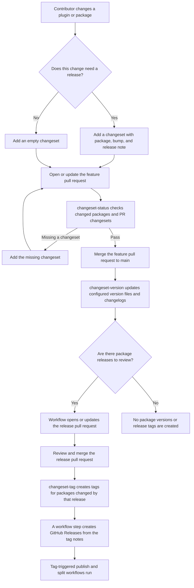

# Changesets (/js/wp-release/v0.18.1/changesets)

### Changesets support [#changesets-support]

The changeset commands manage versioning, changelogs and release tags for single-package repositories and monorepos, including this repository. They read Changesets-style Markdown and load JavaScript configs with descriptors for npm and Composer manifests, plugin and theme headers, readme Stable tags, PHP constants, and Git tags. Use JavaScript configs with ESM (`export default`) or CommonJS (`module.exports`). Frontmatter uses `package-name: patch|minor|major` entries. For pre-releases, use the built-in [pre-release workflow](#pre-releases); the parser supports this simple frontmatter format rather than general YAML or the Changesets pre mode.

PHP projects that don't use Node.js or JavaScript can run the same workflow with [PHP Changesets](../../../php/php-changesets/docs/index.md), a Composer package that needs only PHP and Git. Its `changeset add`, `changeset status`, `changeset version` and `changeset tag` commands take the options of the `changeset-*` commands here, read the same changeset files and print the same release plans, with a PHP config file in place of `wp-release.config.*`. Use `wp-release` when the project already builds with Node.js, or to also build ZIPs, translations and WordPress.org deploys; see the [comparison](../../../php/php-changesets/docs/comparison.md) for the differences.

#### Single-project repositories without a config file [#single-project-repositories-without-a-config-file]

The `changeset-*` commands can release one project at the repository root without a `wp-release.config.*` file. Run them from the root directory. With no version descriptor flags, they detect a root `package.json` or `composer.json` with a version, a plugin entry PHP file with a `Plugin Name` header, or a theme `style.css` with a `Theme Name` header. A detected plugin also updates the Stable tag in `readme.txt`, or `readme.md` when no Stable tag is found in `readme.txt`. Multiple version sources, multiple plugin entry files and npm workspaces require explicit descriptors or a config; files belonging to different projects aren't silently synchronized. A directory without a recognized version source still requires a config or explicit descriptors.

For a root npm package, the complete workflow needs no project flags:

```bash
npx wp-release changeset-add --bump minor --summary "Add a new feature."
npx wp-release changeset-status --since origin/main
npx wp-release changeset-version --dry-run
npx wp-release changeset-version
# Review and commit the updated version and changelog files.
npx wp-release changeset-tag --push
```

A single configured package is selected automatically for `changeset-add --bump` when `--since` isn't supplied, and for `changeset-tag --version`; `--since` still selects changed packages. npm and Composer projects use their root manifest's name as the changeset identifier when that manifest supplies the version; other projects use the root directory's basename. `--project-name <name>` pins the identifier of a repository without a manifest name, so local checkouts and CI don't need matching directory names; a config sets the same identifier with `id`. The fallback uses `.changeset/`, `CHANGELOG.md`, tags named `v{version}`, and the `origin` remote. There is no default comparison branch: pass `--since` or `--base-branch` when status checks should compare changes. Readme changelog updates are opt-in.

Explicit descriptors replace automatic detection and define the entire version target list. For a plugin whose version appears in its header, readme and a PHP constant:

```bash
npx wp-release changeset-version \
  --version-from wordpress-plugin \
  --version-wordpress-plugin my-plugin.php \
  --version-wordpress-stable-tag readme.txt \
  --version-php-constant 'my-plugin.php#MY_PLUGIN_VERSION'
```

The same project flags belong on `changeset-add`, `changeset-status`, `changeset-version` and `changeset-tag`. Keep them consistent across all four commands, for example in command-specific npm scripts. An accompanying `package.json` used for build tools isn't changed unless it is included explicitly.

| Flag | Version descriptor |
|---|---|
| `--version-package-json <file>` | npm manifest version source and target |
| `--version-composer-json <file>` | Composer manifest version source and target; a target without a `version` field is skipped, while a source must have one |
| `--version-wordpress-plugin <file>` | WordPress plugin Version header source and target |
| `--version-wordpress-theme <file>` | WordPress theme Version header source and target |
| `--version-wordpress-stable-tag <file>` | WordPress readme Stable tag source and target; keeps its stable version during pre-releases and snapshots |
| `--version-php-constant <file>#<constant>` | PHP `define()` or `const` version source and target |
| `--version-git-tag <pattern>` | Current version from existing stable Git tags, with a pattern such as `v{version}`; source-only, never a version target |

File descriptor flags are repeatable. The source is inferred from a sole descriptor, or a unique descriptor other than a Stable tag. Otherwise use `--version-from <kind>`, where kind is `package-json`, `composer-json`, `wordpress-plugin`, `wordpress-theme`, `wordpress-stable-tag`, `php-constant` or `git-tag`. For repeated kinds, qualify the selector with the exact descriptor value: `--version-from package-json:package.json` or `--version-from 'php-constant:my-plugin.php#MY_PLUGIN_VERSION'`. Argument order doesn't select the source. A Git source requires a matching existing stable tag; its pattern selects the tags to read, while `--tag-format` controls tags to create. With multiple descriptors, explicitly select `git-tag` if it is the authoritative source.

| Shared option | Config equivalent |
|---|---|
| `--project-name <name>` | `id`, the literal changeset identifier of the root package, instead of the manifest name or checkout directory basename |
| `--base-branch <branch>` | `baseBranch`, used with the remote for the default comparison ref |
| `--remote <name>` | `remote`, used for comparisons and pushing release tags |
| `--changesets-dir <dir>` | `changesets`, relative to the repository root |
| `--readme-changelog` / `--no-readme-changelog` | `readmeChangelog`, independent of updating the readme Stable tag |
| `--changelog-insert-after <marker>` | `changelogInsertAfter`; must exist in `CHANGELOG.md` and, with readme changelog updates, the plugin readme |
| `--tag-format <format>` | `tagFormat`, replacing the default `v{version}` |

An explicit `--config` must load successfully. Otherwise a discovered config takes precedence over the single-project fallback. Single-project descriptor and settings flags cannot be mixed with a config file; put those settings in the config instead. The existing global `--tag-format` override works in both modes. Config files remain the place for package layouts, dependents, custom version and changelog callbacks, deployment destinations and distribution settings. Packaging and deployment commands retain their existing config requirements.

Typical release flow, from a feature pull request to the publish workflows triggered by release tags:



An empty changeset marks a feature PR as no-release. The version workflow consumes it without changing versions, and a release PR containing only its deletion produces no tags.

```js
import { composerJsonVersion, defineConfig, gitTagVersion, packageJsonVersion, wordpressPluginVersion, wordpressStableTag } from '@wpelevator/wp-release';

export default defineConfig( {
	baseBranch: 'main',
	changesets: '.changeset',
	readmeChangelog: true,
	changelogInsertAfter: '<!-- changelog -->',
	root: 'packages',
	tagFormat: '{path}/{version}',
	packages: [
		{ glob: 'js/*', idFrom: 'package.json#name', version: { from: packageJsonVersion(), to: [ packageJsonVersion() ] } },
		{ glob: 'plugins/*', idFrom: 'package.json#name', version: { from: wordpressPluginVersion(), to: [ wordpressPluginVersion(), wordpressStableTag( { ifPresent: true } ), composerJsonVersion( { ifPresent: true } ) ] } },
		{ glob: 'php/*', idFrom: 'composer.json#name', version: { from: gitTagVersion( { pattern: '{path}/{version}' } ), to: [] } },
	],
} );
```

`version.from` selects the current version; `version.to` lists release targets. Use `phpConstantVersion( { file, constant } )` to sync a PHP constant.

#### Single-project checks in GitHub Actions [#single-project-checks-in-github-actions]

There are no dedicated build or changeset wrapper actions. Install the CLI in your project and run it directly. A root npm package can check a pull request with:

```yaml
      - uses: actions/checkout@v7
        with:
          fetch-depth: 0
      - uses: actions/setup-node@v6
        with:
          node-version: 24
      - run: npm ci
      - run: npx --no-install wp-release changeset-status --since origin/main
```

For a plugin with several version targets, put the same descriptor flags in npm scripts for all four changeset commands. Full Git history and tags are needed for comparisons, Git version sources and release notes. Keep the checkout directory name consistent when it supplies the changeset identifier. Directory artifacts use `npx --no-install wp-release build --output dist/my-plugin --github-output`; upload that directory with your artifact action. `build` writes manifest sidecars outside the directory and does not accept the ZIP-only embedding, codec or manifest-filename flags.

#### Packages and tags [#packages-and-tags]

The config describes the repository, so wp-release assumes no directory structure or naming convention of its own:

- **Packages** are the directories that the `glob` of a `packages` entry matches under `root`, with `*`, `?` and `**`, like `plugins/*`, or `.` for a repository with one package at its root. The settings of an entry apply to each of its packages. Discovery never looks inside `.git`, `node_modules`, `vendor` or `dist` directories. A package is identified by its path, or with `idFrom` by the name in its `package.json` or `composer.json`, or with a literal `id` when the group matches exactly one package, and commands that take a package accept a path or identifier.
- **Templates** name the tags and the deploy targets of a package with these placeholders:

  | Placeholder | Value | `plugins/alpha` | Root package |
  |---|---|---|---|
  | `{path}` | Package directory relative to `root`, empty for a package at the root | `plugins/alpha` | (empty) |
  | `{name}` | Package identifier | `plugins/alpha`, or its manifest name with `idFrom` | the manifest name, or the directory name |
  | `{version}` | Released version | `1.2.0` | `1.2.0` |

  Deploy templates also have `{branch}`, `{ref}` and `{revision}` (see [Deploy configured packages](deployment.md#deploy-configured-packages)), and any template can be a callback that receives the package, for names that the placeholders don't cover, like the last directory of the path.
- **`tagFormat`** names the release tags, `{path}/{version}` by default, like `plugins/alpha/1.2.0`. Empty placeholders leave no leading or repeated slashes in a tag, so a package at the root gets plain version tags, like `1.2.0`, from the same default. Deploy templates, like repository URLs, are filled in as they are. A `gitTagVersion()` version source reads the tags with its own `pattern`, also `{path}/{version}` by default, so set both when you change the format.
- **`releaseTitle`** titles the release, like the `title` that `changeset-tag` reports for creating a GitHub Release. The default is `name@version`, like `plugins/alpha@1.2.0`, without the prefix for a package at the repository root, which is titled `1.2.0` like its tag. Like `tagFormat`, it supports `{name}`, `{path}`, `{version}` and `{tag}` placeholders: `releaseTitle: '{version} (beta)'`, or a callback that receives `{ package, version, tag }` like the release notes callback. A template without a placeholder fails at load time, since it would name every release alike. `changeset-tag --release-title <template>` replaces the `releaseTitle` of the config for one command, like `--tag-format` replaces `tagFormat`.
- **`--tag-format <format>`** replaces the `tagFormat` of the config for one command, for a workflow or job that names its tags differently, like `--tag-format '{name}@{version}'`. Every command that creates or reads the same tags needs the same format: `changeset-tag`, which creates them and finds the previous tag for the release notes, `changeset-version --prerelease`, which numbers pre-releases from them, and `deploy-git` and `deploy-svn --release-ref`, which read the package and version of a tag.
- **Slugs** are a WordPress concept: the folder of a plugin or theme. Only the commands that produce something for WordPress use one: the `{slug}/` root folder and name of a `zip`, the `checksums` manifest, the WordPress.org slug of `deploy-svn`, and `version-check`. Each takes `--slug`, which defaults to the name of the working directory, or of the package directory with `zip --package`, and an SVN deploy target takes `slug`, which defaults to the name of the package directory. Tags and Git deploy targets don't have a slug.
- **`remote`** is the git remote that `changeset-tag --push` pushes tags to and that the base branch is compared on, `origin` by default.

The default strategy bumps stable `x.y.z` versions with SemVer rules, and the `x.y` and `x.y.z.w` versions common in WordPress plugins the same way: the bumped part is raised, the parts after it reset to `0`, and the version keeps its number of parts. A minor bump of `2.1` is `2.2` and a major bump is `3.0`, while a patch bump adds the third part, `2.1.1`. A patch bump of `1.2.3.4` is `1.2.4.0`, so raising only the fourth part needs a custom strategy. Configure `nextVersion( { package, bump, currentVersion, changesets } )` for other formats; changeset bumps remain `patch`, `minor` or `major`. Pre-releases are added to the next version with `--prerelease`, described below.

Without `--since`, `changeset-status` compares against `<remote>/<baseBranch>`, where `remote` in the config defaults to `origin` and is also the remote that `changeset-tag --push` pushes tags to; fetch that ref or pass `--since` when using a fork or different upstream. `loadChangesetConfig()` discovers a conventional config at the repository root, unless `--config <path>` selects one explicitly.

Add release notes in a feature PR with `npx wp-release changeset-add`. In a terminal, it lists the packages, marks the ones that changed since `<remote>/<baseBranch>` (or `--since <ref>`) without a changeset, and asks for the packages to release, a `patch`, `minor` or `major` bump for each, and the release note. Choose packages by number, identifier or path, or press Enter to release the changed ones; `none` adds an empty changeset. Changed files include uncommitted and untracked ones, since changesets are usually added before committing.

Without a terminal, or for scripts, pass the changeset as options: `npx wp-release changeset-add --package @vendor/plugin --bump patch --summary "Fix the checkout validation."`. Repeat package and bump flags for multiple packages, or use `--empty` when no release is needed. A package can also be named by its path under `root`, like `plugins/alpha`, and the changeset records its identifier; `changeset-version --package` and `changeset-tag --package` accept paths too. A single `--bump` without `--package` releases every changed package without a changeset, like `changeset-add --bump patch --summary "…"` to fix a failing `changeset-status` check. `--json` and `--github-output` never ask.

In CI, `changeset-status --since origin/main` requires a changeset added by the PR; changesets already on the base do not count, while an empty PR changeset records an explicit no-release decision. Missing-change annotations identify an affected file.

On the release branch, preview with `changeset-version --dry-run`, then run `changeset-version` to update version targets and changelogs. By default, new Markdown entries go before the first version heading; `changelogInsertAfter` sets a literal insertion marker for `CHANGELOG.md` and, with `readmeChangelog`, the plugin readme. Put the marker in both files; a missing marker is an error. Without a marker, plugin readmes use the `== Changelog ==` heading. Failed updates are rolled back for safe retries.

Configure `changelogEntry( { package, changeset, commit } )` to format the changelog entry of each changeset, where `commit` is the `{ hash, shortHash, subject }` of the commit that added the changeset file, if it's committed. The formatted entries go into `CHANGELOG.md`, the `changelog` of each release in the `changeset-version` result, and so the release notes; plugin readmes keep the plain summaries. Without the callback, entries are the plain summaries. For example, to link each entry to its commit:

```js
changelogEntry: ( { changeset, commit } ) =>
	commit
		? `${ changeset.summary } ([\`${ commit.shortHash }\`](https://github.com/me/repo/commit/${ commit.hash }))`
		: changeset.summary,
```

Configure `dependents` to re-release packages that bundle a package when it releases. The dependents come from what the packages declare: a package is a dependent of a source when the spec that it declares in its npm `dependencies` or `optionalDependencies` (or the sections that the policy adds) resolves the current version of the source or points at the workspace, and it re-releases when the next version of the source falls outside the declared range, or always with `when: 'always'`. A pin to an older version selects a registry release instead and `changeset-status` warns about the drift until the pin resolves the package again. Versioning a dependent rewrites its declared specs of the source to the released version, keeping their range prefixes, so an exact pin matches the released workspace again and the built bundle matches the changelog. Wildcards and unpinned ranges accept the release without one, like the `devDependencies` of a package. The derived dependents appear in `changeset-status`, `changeset-version` and `changeset-tag` like any other release, and a dependent that releases for its own reasons keeps its own bump and appends the bundle note:

```js
dependents: {
	bump: 'patch', // Default
	exclude: [ 'actions/wp-release-sign' ], // Package paths under root, or globs over them
},
```

Excluded packages still release with their own changesets and stay out of the automatic re-releases.

When the changesets of a pull request release a source, `changeset-status` requires no changeset for a dependent whose only change is the spec of that source in its `package.json`, since versioning rewrites the spec and the bundle note announces it. Any other change to the dependent, like another manifest field or dependency, documentation or code, needs its own changeset.

The bundle changelog entry defaults to `Bundle <source> <version>.` and is formatted with `dependents.changelog( { package, source } )`:

```js
dependents: {
	changelog: ( { source } ) => `Bundle ${ source.package.name } ${ source.version }.`,
},
```

`dependents.sections` lists the npm dependency sections that declare a source, defaulting to `dependencies` and `optionalDependencies`; add `devDependencies` for dependencies that end up in the dependent's build, or `peerDependencies` to scan them.

The `dependents.dependency` hooks extend the built-in npm scan instead of replacing it, so that both work behind the same range rule and rewrite:

```js
dependents: {
	dependency: {
		// Specs that declare the source outside package.json, like a Composer
		// require in a vendor-isolated directory.
		find: async ( { package: dependent, source } ) => {
			return [ { file: 'vendor-isolated/composer.json', name: '…', spec: '^0.3' } ];
		},
		// Update the declaration to the released version. Call `remember( file )`
		// before writing a file, so failed versioning rolls it back.
		update: async ( { package: dependent, source, specs, version, remember } ) => { /* … */ },
	},
},
```

After versioning, run `npm install --package-lock-only` so that the root lockfile resolves the rewritten pins to the workspace links again; the `Prepare Release` workflow (`prepare-release.yml` in this monorepo) does it with its release pull request.

To release packages separately, for example with a release pull request for each, pass `--package <name>`, repeatable, to version only those packages. A changeset that also names other packages keeps only their entries and its summary, so it still applies to their releases with the same bump. Changesets without packages are left for a run without `--package`.

The `changeset-version` result lists each release with its `package`, `bump`, `currentVersion`, `nextVersion` and `changelog` entries, a Markdown list like the one added to `CHANGELOG.md`. Use it to name and describe the release pull request in a repository script, or call `versionChangesets()` from the library and format the entries of each release with `formatChangelogEntries( release.changesets )`.

After merging the release PR, `changeset-tag --since <merge-commit>^1 --push` pushes tags only for packages changed by that release. It pushes one tag at a time because GitHub doesn't trigger workflows for a push of more than three tags. wp-release doesn't create GitHub Releases: with `--json` or `--github-output`, each entry of `tags` has the `tag`, a `title` like `plugins/alpha@1.2.0` or, for a package at the repository root, the release title like `1.2.0` (see [releaseTitle](#packages-and-tags), and `--release-title` for overriding it in one command), the release `notes` and a `prerelease` flag, for a workflow step like [`softprops/action-gh-release`](https://github.com/softprops/action-gh-release) to create the release (see the example below). For initial adoption, preview all missing tags with `changeset-tag --dry-run` (without `--since`), then push if needed. To release each package with a separate workflow instead, `changeset-tag --since <merge-commit>^1 --untagged --github-output` lists the releases that don't have a tag yet, without creating any. Tag pushes need Git write credentials.

To release a single package, for example from a manual workflow, pass `--package <name>`, repeatable, and with one package `--version <version>` to fail unless the package is at that version. Packages versioned by git tags have no version file, so for them `--version` is the version to tag. Before a tag is created, every `version.to` target must match the version, so a plugin `Version` header that disagrees with its readme `Stable tag` blocks the tag. Versions with a pre-release part, like `1.0.0-rc.1`, have `prerelease` set, so their GitHub Releases can be marked as pre-releases. This example selects one package, so `tags[0]` is its release; these fields are nested in the JSON result:

```yaml
- name: Tag a release
  id: tag
  run: npx wp-release changeset-tag --package "$PACKAGE" --version "$VERSION" --push --github-output

# Creates the GitHub Release, or updates it on a rerun.
- uses: softprops/action-gh-release@v3
  with:
    tag_name: ${{ fromJSON( steps.tag.outputs.result ).tags[0].tag }}
    name: ${{ fromJSON( steps.tag.outputs.result ).tags[0].title }}
    body: ${{ fromJSON( steps.tag.outputs.result ).tags[0].notes }}
    prerelease: ${{ fromJSON( steps.tag.outputs.result ).tags[0].prerelease }}
```

The release notes are the version's `CHANGELOG.md` section, or without one the commits that changed the package since its previous tag, the highest version below the released one, skipping pre-releases for a stable version. Configure `releaseNotes( { package, version, tag, previousTag, changelog, commits, notes } )` to format them, for example to add links; `notes` is the default text and `commits` lists `{ hash, shortHash, subject }`, newest first. `changeset-tag --package <name> --dry-run` prints them without creating the tag.

For local development, run the TypeScript source with `npm run wp-release -- <command>` (for example, `npm run wp-release -- changeset-status --since origin/main`). GitHub workflows use the same CLI for versioning and tagging. `SUBTREE_DEPLOY_TOKEN` lets them update the release PR and push tags, and the `Tag Release` workflow passes it to `softprops/action-gh-release` to create the GitHub Releases.

#### Pre-releases [#pre-releases]

`changeset-version --prerelease <id>` (the `prerelease` option of `versionChangesets()`) releases pre-releases of the next versions, like `1.3.0-rc.1` for a minor bump of `1.2.0`. The identifier, like `alpha`, `beta` or `rc`, can have a number, like `rc.2`, which is used as is and fails when the version is already tagged. Without a number, the number is one above the highest existing tag of that identifier and next stable version, read with the `tagFormat` of the package, so the first one is `rc.1`, and the numbering starts again at `.1` when later changesets raise the next version. The dependents of a source become pre-releases too, so that they bundle its pre-release, unless they're left out with `--no-dependents`.

A pre-release writes every version target except the readme `Stable tag`, which keeps the last stable version since WordPress.org offers it to every site, and `changeset-tag` skips the `Stable tag` when it verifies a pre-release. The changelog gets a section for the pre-release, like `## 1.3.0-rc.1 (2026-10-12)`, so that `changeset-tag` finds its release notes, and the changesets are consumed like in any release.

Since a pre-release consumes the changesets that the stable release needs, run it on a branch that isn't merged, and tag that branch commit:

```sh
git switch --force-create prerelease/plugins/alpha
npx wp-release changeset-version --package plugins/alpha --prerelease rc
git add --all
git commit --message "Prerelease plugins/alpha"
npx wp-release changeset-tag --package plugins/alpha --version 1.3.0-rc.1 --push
```

The base branch keeps its stable versions and pending changesets, so the stable release later versions them as usual, in one changelog section. The tag keeps the pre-release commit reachable after the branch is reset or deleted. The release notes of a stable release compare with the previous stable release, skipping the pre-releases before it, and the `git-tag` version source ignores pre-release tags, so packages versioned by git tags keep building on their last stable version.

#### Snapshots [#snapshots]

`changeset-version --snapshot <id>` (the `snapshot` option of `versionChangesets()`) releases snapshots of the next versions for test builds, like `1.3.0-pr-251.20261012183005` for a pull request: the next version with the identifier, like `pr-251` or `pr-251.0abc123` with a commit hash, and the UTC time, so that every snapshot is unique and they sort by time. Snapshots aren't numbered from tags and can't be combined with `--prerelease`. Like a pre-release, a snapshot writes every version target except the readme `Stable tag`. Build and publish the versioned files without committing them, for example under an npm dist-tag like `pr-251`, since a snapshot consumes the changesets:

```sh
npx wp-release changeset-version --package @vendor/library --snapshot pr-251
npm publish --workspace packages/library --tag pr-251
```
